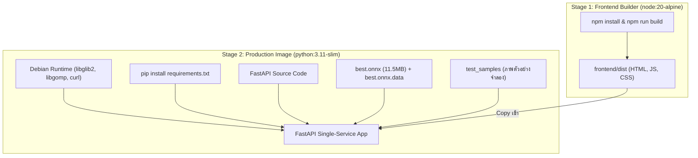

# 🚀 คู่มือการนำระบบขึ้นใช้งานจริง (Deployment Guide)
## ระบบตรวจจับรองเท้าเซฟตี้คนขับรถโม่คอนกรีตด้วย Docker & Render

เอกสารนี้รวบรวมขั้นตอนการ Build Container, การรันด้วย Docker/Docker Compose ภายในเครื่อง และการ Deploy ขึ้นบน Cloud Platform อย่าง **Render** อย่างเป็นขั้นตอน

---

## 1. การทำงานของ Docker Architecture

ระบบใช้ **Multi-Stage Build** ในไฟล์ [Dockerfile](file:///Users/phatchara/Desktop/train-model/Dockerfile) เพื่อให้ได้ Container Image ที่มีขนาดเล็ก ปลอดภัย และมีประสิทธิภาพสูงสุด:



- **Single-Service:** Frontend ถูก Build และถูก Serve โดยตรงจาก FastAPI ที่ Root `/` ทำให้ไม่ต้องตั้งค่า Reverse Proxy ซับซ้อน และหมดปัญหาเรื่อง CORS
- **ขนาด Image เล็ก:** ไม่หลงเหลือ Node.js runtime และไฟล์ที่ไม่จำเป็นใน Production Container
- **ไฟล์ขนาดใหญ่ถูกคัดออก:** [.dockerignore](file:///Users/phatchara/Desktop/train-model/.dockerignore) คัดแยกไฟล์ `safety-shoes.zip` (133MB), ไฟล์โมเดล `.pt` (100MB+), และ cache ออกทั้งหมด ทำให้ Context ส่งเข้า Docker รวดเร็ว

---

## 2. วิธีการรันด้วย Docker ภายในเครื่อง (Local Docker Run)

### วิธีที่ 2.1: รันด้วย Docker Compose (แนะนำ สะดวกที่สุด)
เปิด Terminal ในโฟลเดอร์โปรเจกต์:
```bash
# สั่ง Build และรันในคำสั่งเดียว
docker compose up --build
```
หากต้องการรันเป็นเบื้องหลัง (Background/Daemon):
```bash
docker compose up -d --build
```
- เปิดเบราว์เซอร์ Safari หรือ Chrome ไปที่: **`http://localhost:8000`**
- ตรวจสอบสถานะ Container:
  ```bash
  docker compose ps
  ```
- ดูบันทึกการทำงาน (Logs):
  ```bash
  docker compose logs -f
  ```
- สั่งหยุดการทำงาน:
  ```bash
  docker compose down
  ```

---

### วิธีที่ 2.2: รันด้วยคำสั่ง Docker CLI มาตรฐาน
```bash
# 1. Build Image
docker build -t safety-shoes-detector:latest .

# 2. Run Container (แมปพอร์ต 8000)
docker run -d \
  --name safety-shoes-app \
  -p 8000:8000 \
  --restart unless-stopped \
  safety-shoes-detector:latest

# 3. ดู Logs
docker logs -f safety-shoes-app

# 4. หยุดและลบ Container
docker stop safety-shoes-app && docker rm safety-shoes-app
```

---

## 3. ขั้นตอนการ Deploy บน Render (Render Cloud Deployment)

Render รองรับการ Deploy ผ่าน Docker Web Service โดยตรง:

### ขั้นตอนที่ 1: เตรียม Git Repository
ดันโค้ดขึ้น GitHub หรือ GitLab ของคุณ:
```bash
git add .
git commit -m "feat: complete dockerization and deployment setup"
git push origin main
```

### ขั้นตอนที่ 2: สร้าง Web Service บน Render
1. เข้าสู่ระบบที่ [dashboard.render.com](https://dashboard.render.com)
2. กดปุ่ม **"New +"** เลือก **"Web Service"**
3. เลือก Repository ของคุณ (`train-model` หรือชื่อที่ตั้งไว้)
4. ตั้งค่าในหน้าแบบฟอร์มดังนี้:
   - **Name:** `safety-shoes-detector`
   - **Region:** `Singapore` (ใกล้ประเทศไทยที่สุด ความหน่วงต่ำ)
   - **Branch:** `main`
   - **Runtime:** เลือก **`Docker`**
   - **Dockerfile Path:** `Dockerfile` (ค่าเริ่มต้น)
   - **Instance Type:** `Free` (หรือ Starter ตามการใช้งาน)
5. **Environment Variables (ตัวแปรสภาพแวดล้อม):**
   - `PORT`: `8000`
   - `MODEL_PATH`: `/app/exported_models/best.onnx`
   - `CORS_ORIGINS`: `https://safety-shoes-detector.onrender.com,http://localhost:8000`
6. **Health Check Path:**
   - กรอก: `/api/health`
7. กดปุ่ม **"Create Web Service"**

Render จะดึง Image และรัน Multi-stage Build ตาม `Dockerfile` ให้โดยอัตโนมัติ เมื่อเสร็จสิ้นจะได้รับโดเมน HTTPS เช่น `https://safety-shoes-detector.onrender.com`

---

## 4. ข้อควรทราบเกี่ยวกับ Render Free Tier (Sleep & Cold Start)

1. **โหมดพักการทำงาน (Sleep Mode):**
   - บน Render Free Tier เซอร์วิสจะหลับ (Spin down) หากไม่มีคำขอเข้าใช้งานต่อเนื่องเป็นเวลา 15 นาที
2. **ระยะเวลาตื่น (Cold Start):**
   - การเปิดหน้าเว็บครั้งแรกหลังจากหลับ อาจใช้เวลาประมาณ **30–50 วินาที** ในการบูต Container และโหลดโมเดล ONNX เข้า Memory
3. **การรับมือของหน้าเว็บ:**
   - ระบบมีแถบ **Preflight Banner** ตรวจสอบสถานะการเชื่อมต่ออัตโนมัติ โดยจะแสดงข้อความเตือนให้ผู้ใช้ทราบว่า Backend กำลังตื่นจาก Cold Start และจะปลดล็อกปุ่มเริ่มตรวจจับเมื่อ Backend ตอบกลับ `status: ok` เท่านั้น

---

## 5. การทดสอบความสมบูรณ์หลัง Deploy (Post-Deployment Verification)

1. **ทดสอบ Health Endpoint:**
   ```bash
   curl -s https://<your-app-name>.onrender.com/api/health
   # ผลลัพธ์ที่ถูกต้อง: {"status":"ok","service":"safety-shoes-detector","model_loaded":true}
   ```
2. **ทดสอบ Preflight Endpoint:**
   ```bash
   curl -s https://<your-app-name>.onrender.com/api/preflight
   # ผลลัพธ์ที่ถูกต้อง: {"status":"ok","model_loaded":true,"smoke_test_passed":true,...}
   ```
3. **เปิดหน้าเว็บผ่าน Safari:**
   - เข้า URL ของ Render
   - ทดสอบโหมด **"คลังรูปตัวอย่างจำลอง"** เพื่อทดสอบการตรวจจับผ่าน Cloud
   - ทดสอบโหมด **"ตรวจจับสด"** ด้วยกล้อง USB Webcam ผ่าน HTTPS
